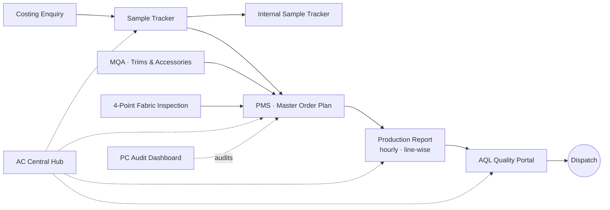

### Garment manufacturing, run on our own digital systems

From the first buyer enquiry to the final dispatch — every step on our floor is tracked in software built in-house by our MIS team.

 

---

## 🏭 About us

**Abhinandan Creation** is an apparel manufacturer. Our MIS team builds the tools that run the business — sampling, costing, production planning, quality control, HR and day-to-day process audits — so that every order, every roll of fabric and every line on the floor is visible in real time.

## 🔄 How our systems connect

## 🧩 Our web apps

> All application repositories are **private** — they are listed here to show the scope of our in-house platform.

### Merchandising & Sampling
| App | What it does |
|---|---|
| 💰 **[Costing Enquiry](https://github.com/AbhinandanCreation/costing-enquiry)** | Buyer enquiry form with Drive-filed attachments, auto-generated PDF summary and instant team notification |
| 🧵 **[Sample Tracker](https://github.com/AbhinandanCreation/sample-tracker)** | Every sample from Fit/Proto → Size Set → PP → GPT, with a Plan-vs-Actual engine and responsibility matrix |
| ✂️ **[Internal Sample Tracker](https://github.com/AbhinandanCreation/internal-sample-tracker)** | Sampling-room jobs: Raw Material → Cutting → Moulding → Stitching → Handover, with team load-balancing |

### Production
| App | What it does |
|---|---|
| 📋 **[PMS — Shop-Floor Entry](https://github.com/AbhinandanCreation/pms-shop-floor)** | Department-wise daily entry that drives the Master Order Plan from cutting to dispatch |
| 📈 **[AC Production Report](https://github.com/AbhinandanCreation/production-report)** | Hourly, line-wise output and efficiency vs SMV-based plan, with style and supervisor dashboards |

### Quality
| App | What it does |
|---|---|
| 🧶 **[4-Point Fabric Inspection](https://github.com/AbhinandanCreation/fabric-4-point-inspection)** | Roll-wise fabric scoring with automatic pass/fail and photo reports |
| 🏷️ **[MQA — Trims & Accessories](https://github.com/AbhinandanCreation/mqa-trims-accessories)** | Staged 10% / 50% / 100% audits of incoming trims, synced with ERPNext |
| ✅ **[AQL Quality Portal](https://github.com/AbhinandanCreation/aql-quality-portal)** | AQL final inspections on the phone with checker- and style-wise dashboards |

### Operations, People & Platform
| App | What it does |
|---|---|
| 🏠 **[AC Central Hub](https://github.com/AbhinandanCreation/ac-central-hub)** | One portal to every app, sheet and dashboard — role-based access and a Help Desk |
| 🔍 **[Checklist Dashboards](https://github.com/AbhinandanCreation/checklist-dashboards)** | PC Audit Dashboard: on-time performance of checklists and FMS, people scorecards, follow-up tickets |
| 🗂️ **[Delegation System](https://github.com/AbhinandanCreation/delegation-system)** | Assign, revise and follow up tasks with weekly scores and daily reminders |
| 👥 **[HR Forms](https://github.com/AbhinandanCreation/hr-forms)** | Grievance, Referral and Reimbursement forms with signatures, print copies and dashboards |
| 🎫 **[Help Ticket Sheet](https://github.com/AbhinandanCreation/help-ticket-sheet)** | Automation that keeps the shared Help Tickets register tidy |

## 🛠️ Tech stack

## ✨ What our systems give us

- **One source of truth** — every app writes to Google Sheets the team already knows
- **Mobile-first** — supervisors and checkers enter data from the floor on their phones
- **Plan vs Actual everywhere** — frozen plan dates, real timestamps, on-time rates
- **Secure by default** — company Google sign-in, role-based access, no secrets in code
- **Built in-house** — changes go live in hours, not weeks

## 📬 Contact

📧 [mis@abhinandancreation.in](mailto:mis@abhinandancreation.in)

© Abhinandan Creation · MIS Team

