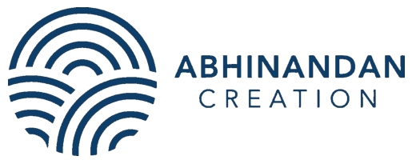
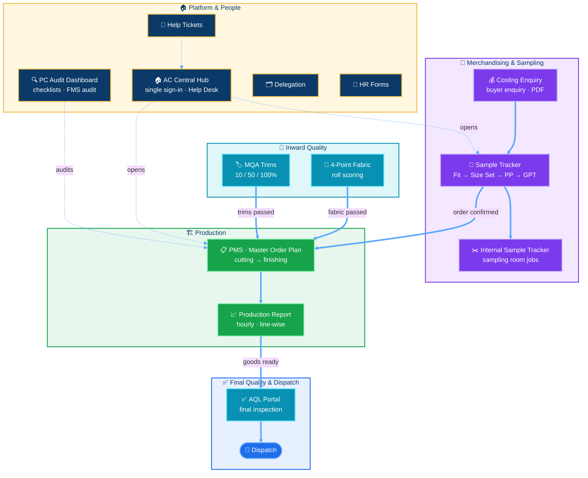

  
  
  
  <!-- LAST_SYNC --><!-- /LAST_SYNC -->

## 🏭 About us

**Abhinandan Creation** is an intimate-wear manufacturer based in Bhiwandi, Maharashtra. We make bras, panties and moulded innerwear for brands. Our MIS team builds the software that runs the business, so that every order, every roll of fabric and every line on the floor can be seen in real time.

- 🧵 **Sampling & costing**: from the first buyer enquiry to the approved sample
- 🏗️ **Production**: daily plans, hourly line output and efficiency
- 🔎 **Quality**: fabric, trims and final AQL inspections, all on the phone
- 👥 **People & process**: HR forms, delegation, checklists and audits

 

### 🏢 Company at a glance

| | |
|---|---|
| 🏷️ **Company** | Abhinandan Creation |
| 👙 **Industry** | Intimate wear & lingerie manufacturing |
| 🧵 **Products** | Bras, panties, moulded innerwear |
| 🤝 **Business model** | Manufacturing for brands (B2B) |
| 📍 **Location** | Bhiwandi, Maharashtra, India |
| 🌐 **Website** | [abhinandancreation.in](https://abhinandancreation.in) |
| 📧 **Email** | [mis@abhinandancreation.in](mailto:mis@abhinandancreation.in) |
| 💻 **Tech team** | In-house MIS team |

  

## 🔄 One order, start to finish

  

## 🗺️ How every system connects

## 🧩 Our web apps

> 🔒 All app repositories are **private**. They are listed here to show the scope of our in-house platform.

<table>
<tr>
<td colspan="2" align="center"><h3>🧵 Merchandising & Sampling</h3></td>
</tr>
<tr>
<td width="50%" valign="top">

### 💰 [Costing Enquiry](https://github.com/AbhinandanCreation/costing-enquiry)
Buyer enquiry form: guided flows, Drive-filed attachments, an auto-made **PDF summary** and instant team alerts.

  

</td>
<td width="50%" valign="top">

### 🧵 [Sample Tracker](https://github.com/AbhinandanCreation/sample-tracker)
Every sample from Fit/Proto → Size Set → PP → GPT, with a **Plan-vs-Actual engine** and a responsibility matrix.

 

</td>
</tr>
<tr>
<td colspan="2" valign="top">

### ✂️ [Internal Sample Tracker](https://github.com/AbhinandanCreation/internal-sample-tracker)
Sampling-room jobs: **Raw Material → Cutting → Moulding → Stitching → Handover**, with automatic team load-balancing, linked live to the Sample Tracker.

 

</td>
</tr>

<tr>
<td colspan="2" align="center"><h3>🏗️ Production</h3></td>
</tr>
<tr>
<td width="50%" valign="top">

### 📋 [PMS: Shop-Floor Entry](https://github.com/AbhinandanCreation/pms-shop-floor)
Department-wise daily entry on the phone that drives the **Master Order Plan** from cutting to dispatch.

 

</td>
<td width="50%" valign="top">

### 📈 [AC Production Report](https://github.com/AbhinandanCreation/production-report)
Hourly, line-wise output and **efficiency against an SMV-based plan**, with style and supervisor dashboards.

 

</td>
</tr>

<tr>
<td colspan="2" align="center"><h3>🔎 Quality</h3></td>
</tr>
<tr>
<td width="50%" valign="top">

### 🧶 [4-Point Fabric Inspection](https://github.com/AbhinandanCreation/fabric-4-point-inspection)
Roll-wise fabric scoring with automatic **pass / fail** and photo reports saved to Drive.

 

</td>
<td width="50%" valign="top">

### 🏷️ [MQA: Trims & Accessories](https://github.com/AbhinandanCreation/mqa-trims-accessories)
Staged **10% → 50% → 100%** audits of incoming trims, synced every hour with ERPNext.

 

</td>
</tr>
<tr>
<td colspan="2" valign="top">

### ✅ [AQL Quality Portal](https://github.com/AbhinandanCreation/aql-quality-portal)
AQL final inspections on the phone, with dashboards by checker and by style.

 

</td>
</tr>

<tr>
<td colspan="2" align="center"><h3>👥 Operations, People & Platform</h3></td>
</tr>
<tr>
<td width="50%" valign="top">

### 🏠 [AC Central Hub](https://github.com/AbhinandanCreation/ac-central-hub)
One portal for every app, sheet and dashboard, with **role-based access** and a built-in Help Desk.

</td>
<td width="50%" valign="top">

### 🔍 [Checklist Dashboards](https://github.com/AbhinandanCreation/checklist-dashboards)
PC Audit Dashboard: on-time performance for checklists and FMS, people scorecards and follow-up tickets.

</td>
</tr>
<tr>
<td width="50%" valign="top">

### 🗂️ [Delegation System](https://github.com/AbhinandanCreation/delegation-system)
Assign, revise and follow up on tasks, with weekly scores and daily email reminders.

</td>
<td width="50%" valign="top">

### 👥 [HR Forms](https://github.com/AbhinandanCreation/hr-forms)
Grievance, Referral and Reimbursement forms with signatures, print copies and dashboards.

</td>
</tr>
<tr>
<td colspan="2" valign="top">

### 🎫 [Help Ticket Sheet](https://github.com/AbhinandanCreation/help-ticket-sheet)
Automation that keeps the shared Help Tickets register tidy: solved tickets move out, reopened tickets move back.

</td>
</tr>
</table>

## 🛠️ Built with

  

## ✨ Why we build our own

| | |
|---|---|
| 📊 **One source of truth** | Every app writes to the Google Sheets the team already knows |
| 📱 **Mobile-first** | Supervisors and checkers enter data from the floor on their phones |
| ⏱️ **Plan vs Actual everywhere** | Frozen plan dates, real timestamps, on-time rates |
| 🔐 **Secure by default** | Company Google sign-in, role-based access, no secrets in code |
| ⚡ **Fast to change** | Built in-house, so changes go live in hours, not weeks |

## 📬 Get in touch

